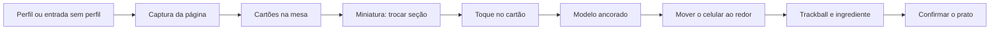

# MenuLens — Design Review

**MAC0623 — Interação 3D em Realidades Mistas**  
**Checkpoint formativo da Parte 2 · entrega 21 de outubro de 2026**  
**Equipe:** 3 pessoas · **Stack:** three.js + WebXR (`immersive-ar`, celular Android)

Este documento destila a especificação geral para a reunião de 10 minutos. Não substitui o relatório final.

---

## 1. Problema refinado, usuário e ODS

### 1.1 Problema

Num restaurante fora do próprio país, o cardápio concentra tudo o que a pessoa precisaria saber e, ao mesmo tempo, esconde esse conteúdo: o nome do prato está em outra língua, a preparação é desconhecida, e calorias, gorduras e alergênicos não estão escritos de um jeito que ela consiga usar. Fotografar o cardápio e jogar o texto num tradutor devolve palavras, não uma decisão. A pessoa ainda não vê o prato, não sabe se há camarão no molho e não consegue comparar duas opções com o próprio corpo e os próprios gostos em mente.

### 1.2 Usuário-alvo

Laura, pessoa adulta, recém-chegada, comendo fora no Brasil com um cardápio em português. É peruana, não fala muito português, Não é cozinheira, não é nutricionista e não está em consulta clínica. Quer responder, em poucos minutos, à mesa:

- O que é este prato, em linguagem que eu entenda?
- Quais são os ingredientes e há algo a que eu sou alérgico?
- A carga de energia e gordura é leve ou pesada?
- Este prato combina com o que eu gosto (picante, salgado, doce)?
- Como ele é descrito por quem já pediu?

### 1.3 ODS

**Objetivo 3 — Saúde e bem-estar.** Assegurar uma vida saudável e promover o bem-estar para todas e todos, em todas as idades.

**Meta 3.4.** Até 2030, reduzir em um terço a mortalidade prematura por doenças não transmissíveis por meio de prevenção e tratamento, e promover a saúde mental e o bem-estar.

A meta 3.4 trata de prevenção: reduzir dano evitável antes que ele aconteça. Comer fora é uma decisão repetida em que calorias, gorduras e alergênicos importam, e em que uma reação alérgica é um dano imediato. Essa prevenção só é possível se a pessoa consegue ler o que vai comer. O usuário-alvo é quem hoje não consegue: a informação está no cardápio, numa língua que não lê, sobre pratos que não reconhece. Sem nome traduzido, sem ingredientes visíveis e sem aviso de alergênico, a escolha vira um chute. Um chute desses não é um inconveniente de viagem; é uma falha de prevenção no momento em que a pessoa decide o que entra no corpo.

A **tarefa** é escolher um prato seguro e adequado ao gosto e à carga, não “ver um modelo 3D de comida”. O **usuário** é a pessoa sem acesso linguístico ao cardápio. A **avaliação** mede se ela identifica o alergênico, reconhece a faixa de energia e gordura e recusa o prato inadequado. Tempo e preferência entram junto; o acerto da escolha preventiva é o que a meta exige.

## 2. Desenho da interação

### 2.1 Navegação — locomoção real do celular

**Técnica.** O prato fica ancorado na mesa. A pessoa navega movendo o aparelho para ver o modelo de lado, de cima ou de perto. O objeto permanece no mundo enquanto a câmera se desloca.

**Justificativa.** A tarefa acontece sentada, numa superfície só, no espaço real. Locomoção contínua virtual reabriria vection: a pessoa já está no restaurante. Teleporte de avatar também não corresponde.

### 2.2 Seleção — plano de imagem, pelo toque na tela

**Técnica.** Seleção por plano de imagem. A tela do celular é o plano. O toque lança um raio da câmera pelo pixel tocado e acerta o cartão do prato. Há realce antes de confirmar.

**Justificativa.** Os alvos estão na imagem da câmera, a meio metro ou um metro da lente, projetados na tela. Cone seria ambíguo: os cartões são vizinhos. Mão virtual e Go-Go pedem uma mão rastreada em 6DoF, que este aparelho não tem. Ray casting com controlador fica de fora pelo mesmo motivo: não há controlador.

### 2.3 Manipulação — trackball de toque, com retorno amortecido

**Técnica.** Trackball da A2, passado para o dedo. Um arraste gira o prato em torno do eixo vertical, com inclinação limitada. Rotação livre em seis eixos viraria o prato de cabeça para baixo. Soltar não teleporta o objeto: um integrador amortecido devolve prato e ingrediente à mesa. A disciplina rascunho–justificar–construir–verificar da A1 vale aqui, porque a técnica não é cópia literal do exercício de headset.

Um segundo gesto, o arraste vertical no ingrediente, puxa esse ingrediente ao longo de uma guia. Um toque no ingrediente afastado mostra o nome. É a profundidade da equipe de três pessoas, a serviço da meta 3.4: ver o camarão, não só ler a palavra.

**Justificativa.** O objeto está no espaço pessoal, na mesa em que a pessoa vai comer. Grab direto da A2 pediria controlador ou mão rastreada. Gizmo de translação não acrescenta: o prato permanece ancorado. Mover o celular já mostra outro lado; o trackball entra quando a mesa está cheia ou quando a pessoa quer giro fino sem perder o painel.

**Pronto quando.** A pessoa gira o prato, afasta um ingrediente, lê o rótulo e vê os dois objetos assentarem sem atravessar a mesa.

---

## 3. Avaliação de risco de conforto

A pessoa está no restaurante real, com o celular na mão, apontado para a mesa. Vocabulário do Módulo 3 e da A4.


| Fonte | Onde aparece neste desenho | Mitigação |
| --- | --- | --- |
| **Vection** | Câmera virtual andando com o corpo parado | Não entra. A vista só se move quando a pessoa move o celular. Visão e vestibular concordam: caso típico de AR no telefone. |
| **Conflito sensorial** | O prato “nada” na mesa quando o rastreamento escorrega, enquanto a sala vista pela câmera fica firme | Hit-test estável no tampo. Se o rastreamento se perde, a interface pede para apontar de novo a mesa, em vez de deixar o modelo flutuando. |
| **VAC (vergência–acomodação)** | Texto 3D miúdo colado na câmera, com o olho focado na tela | Nutrição, alergênicos e resenha ficam no overlay 2D, no plano em que o olho já foca. O 3D é o prato e os ingredientes, grandes o bastante na mesa. |
| **Latência** | Toque que atrasa; âncora que nasce fora do tampo | Seleção e giro no quadro da sessão. OCR uma vez, na captura, não a cada frame. |
| **Braço de gorila** | Celular na altura do ombro durante a tarefa inteira | Cardápio e prato estão na mesa: o aparelho aponta para baixo. Tarefa curta (cerca de 20 min no estudo). A miniatura evita varrer o papel com o braço erguido. |
| **Pescoço** | Alternar o tempo todo entre tela e tampo | Os cartões estão na imagem da câmera. A pessoa olha a tela enquanto a câmera olha a mesa. |

O SSQ entra depois da condição no celular. A expectativa é escore baixo: não há locomoção virtual. O piloto pode revelar incômodo de braço ou náusea se a âncora falhar. Se isso aparecer, o ajuste é âncora mais estável ou tarefa mais curta, e o relatório diz qual foi a troca.

---

## 4. Plano de avaliação

Desenho segundo o Módulo 4. Participantes externos à equipe. Instrumentos validados junto de métricas da tarefa.

### 4.1 Pergunta

Diante de um cardápio numa língua que não lê, a pessoa identifica melhor o prato compatível com uma restrição alimentar e com a carga nutricional quando usa o MenuLens do que quando usa o mesmo cardápio apenas traduzido, em página estática?

Essa pergunta amarra a meta 3.4 à medida: o acerto da escolha preventiva, não só a preferência pela interface.

### 4.2 Desenho

**Intra-sujeitos (within-subjects).** Cada participante faz as duas condições. Com n pequeno (3 a 8), a variação individual de familiaridade com XR e com comida seria maior do que o efeito num desenho entre-sujeitos.

| Condição | O que a pessoa vê |
| --- | --- |
| A | Cardápio traduzido estático, no monitor, sem modelo 3D e sem destaque de perfil. |
| B | MenuLens no Android da equipe, apontado para o cardápio impresso na mesa, mesma persona. |

**Contrabalanceamento.** Metade começa por A, metade por B. Dois cardápios (ou duas personas no mesmo idioma) para a segunda tentativa não ser memória da primeira. A ordem dos cardápios também alterna.

**Persona da tarefa, não gosto livre.** Exemplo: alérgica a crustáceos, prefere pouco picante, quer algo leve. Pelo menos um prato atraente pelo nome traduzido contém o alergênico. A resposta certa é um prato elegível e leve.

O usuário-alvo continua sendo a pessoa estrangeira. Na amostra, entram estudantes internacionais quando o recrutamento permitir. Participante brasileiro pode fazer a tarefa com o cardápio em japonês ou árabe: a barreira de idioma fica real sem exigir que toda a amostra esteja viajando. O relatório descreve quem de fato participou.

### 4.3 Participantes e recrutamento

- Mínimo da rubrica: **3 pessoas externas à equipe**.
- Meta de trabalho: **6**.
- Fonte: estudantes internacionais e conhecidos fora do curso; alunos de MAC0623 só como reserva, com o viés declarado no relatório.
- Recrutamento a partir de **16 de novembro**, para haver número antes da apresentação de 2 de dezembro.
- Um piloto com 1 pessoa externa na semana de 12–18 de novembro, para caber em ~20 minutos e testar legibilidade dos cartões.

### 4.4 Métricas e instrumentos

Métricas da tarefa: acerto (o prato respeita o alergênico da persona e a faixa de carga); identificação (apontar o alergênico de um prato indicado e ler energia/gordura em faixa, não o número exato); tempo até confirmar; quantidade de pratos inspecionados.

| Instrumento | Papel |
| --- | --- |
| SUS (Brooke, 1996) | Usabilidade percebida, depois de cada condição, com o mesmo critério para todos. |
| NASA-TLX (Hart e Staveland, 1988) | Carga de trabalho. A condição AR pode acertar mais e custar mais. |
| SSQ (Kennedy et al., 1993) | Conforto, depois da condição no celular. |

Com n pequeno não há teste de hipótese inflado. O relatório mostra acertos, tempos e escores, o que surpreendeu e o que a equipe mudaria. Empate ou vitória do cardápio estático são resultados aceitáveis se estiverem bem contados.

---

## 5. Storyboards do fluxo central

Cada quadro é a tela do celular sobre a mesa real. Servem como equivalente visual desta seção no Design Review.



**Quadro A — Apontar para o cardápio.**  
Câmera vê o papel. Cartões ancorados sobre os pratos: dois ou três com marca de recomendação, um com marca de alergênico. No canto, a miniatura das seções.

**Quadro B — Selecionar.**  
O dedo toca um cartão na imagem. O cartão realça. Nome original e tradução visíveis. Confirmar assenta o modelo.

**Quadro C — Inspecionar.**  
Prato 3D na mesa real, sombra no tampo. A pessoa deslocou o celular para o lado; o prato continuou no mesmo ponto. O dedo arrasta para girar. Overlay: ingredientes, energia, gorduras, alergênicos, duas linhas de resenha. Selo “estimativa” na nutrição.

**Quadro D — Abrir o ingrediente.**  
Ingrediente puxado acima do prato ao longo da guia. Rótulo legível. O prato segue ancorado.

```text
┌─────────────────────────────────┐     ┌─────────────────────────────────┐
│ A  câmera no papel              │     │ B  toque no cartão              │
│  ┌───────────────────────────┐  │     │  ┌───────────────────────────┐  │
│  │  [★ Moqueca]  [Feijoada]  │  │     │  │  [★ Moqueca] ← toque      │  │
│  │  [⚠ Camarão]  [Salada]    │  │     │  │   realce + confirmar      │  │
│  │                           │  │     │  │  Moqueca / Moqueca        │  │
│  └───────────────────────────┘  │     │  └───────────────────────────┘  │
│  [Entradas|Principais|Doces]    │     │  [Entradas|Principais|Doces]    │
└─────────────────────────────────┘     └─────────────────────────────────┘

┌─────────────────────────────────┐     ┌─────────────────────────────────┐
│ C  prato na mesa, celular ao    │     │ D  ingrediente na guia          │
│    lado; overlay de nutrição    │     │                                 │
│         ╭──────╮                │     │           ○ camarão             │
│        ╱ prato  ╲   estimativa  │     │           │                     │
│        ╲  3D   ╱    450 kcal    │     │         ╭─┴────╮                │
│         ╰──────╯    gorduras    │     │        ╱ prato  ╲               │
│         sombra                  │     │        ╲   3D   ╱               │
└─────────────────────────────────┘     └─────────────────────────────────┘
```

---

## 6. Plano das seis semanas restantes

A partir de 21 de outubro. Apresentação em 2 de dezembro; código e relatório em 11 de dezembro.

Papéis (sobrepostos nas fronteiras; avaliação e apresentação dos três):

| Pessoa | Conduz |
| --- | --- |
| 1. Interação XR | Sessão `immersive-ar`, hit-test, locomoção do celular, toque, trackball, amortecimento, sombra |
| 2. Fluxo e interface | Cartões, painéis, estados recomendado/bloqueado, perfil, roteiro do estudo |
| 3. Dados e serviços | Base dos três cardápios, ranking, API, OCR, registro da tarefa |

Profundidade que uma dupla não seria obrigada a fechar junta: ranking do perfil no cardápio; puxar ingredientes na guia; três idiomas e estado de confiança baixa.

### 22 de outubro – 11 de novembro · protótipo

Meta do dia 11: uma pessoa de fora aponta o Android para um cardápio impresso e completa a tarefa central, mesmo feia. Vídeo da tela como reserva.

| Pessoa | Pronto em 11 de novembro |
| --- | --- |
| 1 | Hit-test, cartões ancorados, toque, prato que gira e volta amortecido, sombra. Contornar o prato com o celular. |
| 2 | Cartão com nome original e tradução. Painel de ingredientes, energia, gorduras, alergênicos e resenha. Um cartão bloqueado. Miniatura de seções. |
| 3 | `GET /menus/{id}` com um cardápio da base. Ranking num teste simples. Captura pode usar um quadro já conhecido. |
| Todos | Demo de 3 minutos e autoavaliação de 1 página. |

Corte se o tempo apertar: segundo idioma e cardápio desconhecido esperam. Toque, prato ancorado e um painel verdadeiro não esperam.

### 12 de novembro – 1 de dezembro · profundidade e estudo

| Semana | Foco |
| --- | --- |
| 12–18 nov | Guia de ingredientes; ajuste de âncora e de braço. Segundo e terceiro cardápios; `POST /menus/scan`. Piloto com 1 pessoa externa. Recrutar. |
| 19–25 nov | Correções do piloto. Três heróis ou texturas de categoria. Base congelada. Sessões no Android, cardápio impresso. SUS, NASA-TLX, SSQ. |
| 26 nov – 1 dez | Build estável, vídeo de reserva, figuras da apresentação, tabelas, ensaio de 12 minutos. |

### 2 de dezembro · apresentação

12 minutos + 3 de perguntas. Os três falam. Demo ao vivo no celular; vídeo gravado na véspera como reserva.

### 3–11 de dezembro · código e relatório

Relatório de 8–10 páginas. README que abre no Android, sem dados nominais de participante.

---

## 7. Riscos que a reunião de 10 minutos precisa cravar

- **Celular e Chrome.** `immersive-ar` pede Android, Chrome e HTTPS. iPhone não entra. Um aparelho da equipe desde esta semana; mesa fosca no estudo; demo gravada antes de 2 de dezembro.
- **Recrutamento.** Menos de três pessoas externas zera a lógica da rubrica. Lista na semana do piloto; reserva declarada: alunos de fora da equipe.
- **Conforto.** Braço cansado ou prato que desliza. Tarefa curta, âncora estável, SSQ no piloto.
- **OCR misturado com interação.** O papel do estudo é um cardápio da base, com boa luz. Cardápio desconhecido fica fora da métrica.

---

## Referências usadas neste checkpoint

- Nações Unidas. ODS 3, Meta 3.4.
- Brooke, J. (1996). SUS.
- Hart, S. G., & Staveland, L. E. (1988). NASA-TLX.
- Kennedy, R. S. et al. (1993). Simulator Sickness Questionnaire.
- Taxonomia de seleção da Aula 7; WIM da A3; trackball da A2; vocabulário de conforto do Módulo 3 e da A4.
