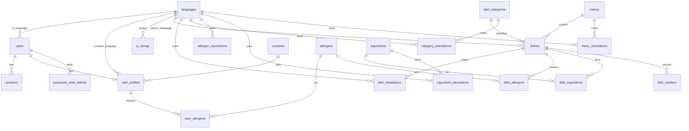

# MenuLens — Especificação da base de dados

## 1. Decisões que valem para todas as tabelas

- Chaves: `INTEGER PRIMARY KEY` (SQLite) ou `UUID` se a equipe migrar para PostgreSQL. Neste documento: inteiro autoincremental.
- Tempos: `TEXT` ISO-8601 em UTC (`2026-10-17T22:00:00Z`).
- Soft delete só onde o histórico importa (`users`, `dishes`). O resto apaga de verdade.
- Nomes em inglês no esquema, para o código Python e o JSON da API coincidirem. Textos visíveis ao usuário entram nas tabelas de tradução.
- Nada de senha, token cru ou dado de participante do estudo no repositório git.

### 1.1 Imagem e modelo 3D: arquivo no disco, caminho na tabela

Um JPEG e um GLB não são linhas. São arquivos. A base guarda só a **rota relativa** e metadados (mime, tamanho, escala).

```text
media/
  dishes/
    12/
      image.jpg          ← foto de referência
      model.glb          ← malha do prato, se houver
  categories/
    soup/
      model.glb          ← fallback da categoria
  ui/
    flags/...
```

## Na API o cliente recebe uma URL pública, por exemplo `/media/dishes/12/model.glb`. O servidor estático ou o FastAPI servem o arquivo. three.js carrega esse GLB com `GLTFLoader`.


## 2. Diagrama




---


## 3. Autenticação e sessões

A senha nunca é gravada. O que entra em `users.password_hash` é um hash **Argon2id** (ou bcrypt, se o ambiente não tiver argon2). O token de sessão sai uma vez no login, em texto; na tabela fica só o SHA-256 desse token. Quem rouba o ficheiro da base não entra na conta.

### 3.1 `users`

Conta de login. O perfil alimentar é outra tabela: a pessoa pode ter conta e ainda não ter perfil (RF-02).


| Coluna          | Tipo    | Restrição          | Notas                                  |
| --------------- | ------- | ------------------ | -------------------------------------- |
| `id`            | INTEGER | PK                 |                                        |
| `email`         | TEXT    | UNIQUE NOT NULL    | Normalizar: minúsculas, trim.          |
| `password_hash` | TEXT    | NOT NULL           | Argon2id. Nunca devolver na API.       |
| `is_active`     | INTEGER | NOT NULL DEFAULT 1 | `0` bloqueia login sem apagar a conta. |
| `created_at`    | TEXT    | NOT NULL           | UTC.                                   |
| `updated_at`    | TEXT    | NOT NULL           | UTC.                                   |
| `last_login_at` | TEXT    | NULL               |                                        |
| `deleted_at`    | TEXT    | NULL               | Soft delete.                           |


Índice: `email`. Não há índice em `password_hash`.

### 3.2 `sessions`

Uma linha por aparelho ou por login. Logout e troca de senha revogam.


| Coluna       | Tipo    | Restrição                                | Notas                                                  |
| ------------ | ------- | ---------------------------------------- | ------------------------------------------------------ |
| `id`         | INTEGER | PK                                       |                                                        |
| `user_id`    | INTEGER | NOT NULL FK → users.id ON DELETE CASCADE |                                                        |
| `token_hash` | TEXT    | UNIQUE NOT NULL                          | SHA-256 do token opaco.                                |
| `created_at` | TEXT    | NOT NULL                                 |                                                        |
| `expires_at` | TEXT    | NOT NULL                                 | Ex.: 14 dias.                                          |
| `revoked_at` | TEXT    | NULL                                     | Preenchido no logout.                                  |
| `user_agent` | TEXT    | NULL                                     | Só para a pessoa reconhecer o aparelho.                |
| `ip_prefix`  | TEXT    | NULL                                     | Prefixo, não o IP completo, se guardarem alguma coisa. |


Índices: `user_id`, `expires_at`, `token_hash`.

Regras da API:

1. Login: verifica o hash da senha, cria um token aleatório de 32 bytes, grava `sha256(token)`, devolve o token cru uma vez (cookie `HttpOnly` + `Secure`, ou header).
2. Pedido autenticado: hasheia o token recebido e procura sessão não revogada e não expirada.
3. Logout: `revoked_at = agora`.
4. Troca de senha: revoga **todas** as sessões desse `user_id`.
5. Não existe `password` em texto em log, cookie ou tabela.


### 3.3 `password_reset_tokens`

Opcional no curso, mas já deixa a recuperação sem inventar um campo na sessão.


| Coluna       | Tipo    | Restrição                                | Notas                                             |
| ------------ | ------- | ---------------------------------------- | ------------------------------------------------- |
| `id`         | INTEGER | PK                                       |                                                   |
| `user_id`    | INTEGER | NOT NULL FK → users.id ON DELETE CASCADE |                                                   |
| `token_hash` | TEXT    | UNIQUE NOT NULL                          | SHA-256. O e-mail leva o token cru, de uso único. |
| `expires_at` | TEXT    | NOT NULL                                 | Curto: 1 hora.                                    |
| `used_at`    | TEXT    | NULL                                     |                                                   |


---


## 4. Idiomas e textos da UI


### 4.1 `languages`

Catálogo dos idiomas da interface **e** dos conteúdos (nome do prato, alergénico, categoria). Um código BCP 47 por linha.


| Coluna          | Tipo    | Restrição          | Notas                                             |
| --------------- | ------- | ------------------ | ------------------------------------------------- |
| `id`            | INTEGER | PK                 |                                                   |
| `code`          | TEXT    | UNIQUE NOT NULL    | `pt-BR`, `es`, `en`, `ja`, `ar`.                  |
| `name_native`   | TEXT    | NOT NULL           | Como o idioma se chama a si próprio: `Português`. |
| `is_rtl`        | INTEGER | NOT NULL DEFAULT 0 | `1` para árabe.                                   |
| `is_ui_enabled` | INTEGER | NOT NULL DEFAULT 1 | Idiomas que a UI oferece no seletor.              |


Semente mínima: `pt-BR` (UI do estudo), `es`, `en`, e o idioma do segundo e do terceiro cardápio.

### 4.2 `ui_strings`

Cada chave da interface numa linha por idioma. O frontend pede `GET /i18n/{code}` e recebe `{ "profile.title": "Perfil", ... }`.


| Coluna        | Tipo    | Restrição                  | Notas                                       |
| ------------- | ------- | -------------------------- | ------------------------------------------- |
| `id`          | INTEGER | PK                         |                                             |
| `language_id` | INTEGER | NOT NULL FK → languages.id |                                             |
| `key`         | TEXT    | NOT NULL                   | `profile.allergens`, `dish.estimate_badge`. |
| `value`       | TEXT    | NOT NULL                   | Texto já na língua.                         |


UNIQUE (`language_id`, `key`).

Não traduzir prato nesta tabela. Prato tem `dish_translations`. Misturar as duas coisas impede filtrar o cardápio por idioma.

---


## 5. Perfil do utilizador


### 5.1 `countries`

Lista curta para o seletor. Código ISO 3166-1 alpha-2.


| Coluna    | Tipo    | Restrição                          |
| --------- | ------- | ---------------------------------- |
| `id`      | INTEGER | PK                                 |
| `code`    | TEXT    | UNIQUE NOT NULL (`PE`, `BR`, `JP`) |
| `name_en` | TEXT    | NOT NULL                           |


### 5.2 `user_profiles`

Um perfil por conta (`user_id` UNIQUE). Idade, altura e peso **não** entram no ranking (RF-03); só pré-preenchem `load_preference`.


| Coluna                | Tipo    | Restrição                                       | Notas                                             |
| --------------------- | ------- | ----------------------------------------------- | ------------------------------------------------- |
| `id`                  | INTEGER | PK                                              |                                                   |
| `user_id`             | INTEGER | UNIQUE NOT NULL FK → users.id ON DELETE CASCADE |                                                   |
| `country_id`          | INTEGER | NULL FK → countries.id                          | País de origem.                                   |
| `ui_language_id`      | INTEGER | NOT NULL FK → languages.id                      | Língua da interface.                              |
| `content_language_id` | INTEGER | NOT NULL FK → languages.id                      | Língua em que quer ver nome e descrição do prato. |
| `age_years`           | INTEGER | NULL CHECK (16–120)                             |                                                   |
| `height_cm`           | INTEGER | NULL CHECK (80–250)                             |                                                   |
| `weight_kg`           | REAL    | NULL CHECK (20–400)                             |                                                   |
| `taste_sweet`         | INTEGER | NOT NULL DEFAULT 3 CHECK (1–5)                  | Doce.                                             |
| `taste_salty`         | INTEGER | NOT NULL DEFAULT 3 CHECK (1–5)                  | Salgado.                                          |
| `taste_spicy`         | INTEGER | NOT NULL DEFAULT 3 CHECK (1–5)                  | Picante.                                          |
| `accepts_alcohol`     | INTEGER | NOT NULL DEFAULT 1                              | `0` bloqueia pratos com `contains_alcohol = 1`.   |
| `load_preference`     | TEXT    | NOT NULL DEFAULT `'indifferent'`                | `light` | `indifferent` | `hearty`.               |
| `created_at`          | TEXT    | NOT NULL                                        |                                                   |
| `updated_at`          | TEXT    | NOT NULL                                        |                                                   |


Sem perfil, o cardápio sai neutro: sem destaque e sem bloqueio.

### 5.3 `user_allergens`

N:N entre perfil e o catálogo Anvisa.


| Coluna        | Tipo    | Restrição                                        |
| ------------- | ------- | ------------------------------------------------ |
| `profile_id`  | INTEGER | NOT NULL FK → user_profiles.id ON DELETE CASCADE |
| `allergen_id` | INTEGER | NOT NULL FK → allergens.id                       |


PK (`profile_id`, `allergen_id`).

---


## 6. Alergénicos, categorias e cardápios


### 6.1 `allergens`

Lista fechada da RDC Anvisa nº 26/2015 (e equivalentes óbvios: glúten via trigo/centeio/cevada/aveia). O nome visível está em `allergen_translations`.


| Coluna          | Tipo    | Restrição          | Notas                                                                                         |
| --------------- | ------- | ------------------ | --------------------------------------------------------------------------------------------- |
| `id`            | INTEGER | PK                 |                                                                                               |
| `code`          | TEXT    | UNIQUE NOT NULL    | `crustaceans`, `eggs`, `fish`, `milk`, `peanuts`, `soy`, `tree_nuts`, `wheat`, `sulphites`, … |
| `anvisa_listed` | INTEGER | NOT NULL DEFAULT 1 |                                                                                               |


### 6.2 `allergen_translations`


| Coluna        | Tipo    | Restrição                                    |
| ------------- | ------- | -------------------------------------------- |
| `allergen_id` | INTEGER | NOT NULL FK → allergens.id ON DELETE CASCADE |
| `language_id` | INTEGER | NOT NULL FK → languages.id                   |
| `label`       | TEXT    | NOT NULL                                     |


PK (`allergen_id`, `language_id`). Ex.: `crustaceans` + `pt-BR` → `Crustáceos`.

### 6.3 `dish_categories`

Entrada, principal, bebida, sobremesa, acompanhamento. O fallback 3D da categoria vive aqui.


| Coluna                | Tipo    | Restrição          | Notas                                          |
| --------------------- | ------- | ------------------ | ---------------------------------------------- |
| `id`                  | INTEGER | PK                 |                                                |
| `code`                | TEXT    | UNIQUE NOT NULL    | `starter`, `main`, `drink`, `dessert`, `side`. |
| `fallback_model_path` | TEXT    | NULL               | `media/categories/main/model.glb`.             |
| `sort_order`          | INTEGER | NOT NULL DEFAULT 0 | Ordem na miniatura de seções.                  |


### 6.4 `category_translations`

PK (`category_id`, `language_id`): `label` (`Entradas`, `Pratos principais`).

### 6.5 `menus` e `menu_translations`

Os três cardápios curados do curso.


| Coluna               | Tipo    | Restrição                  | Notas                           |
| -------------------- | ------- | -------------------------- | ------------------------------- |
| `id`                 | INTEGER | PK                         |                                 |
| `code`               | TEXT    | UNIQUE NOT NULL            | `br-pt`, `jp`, `pe`.            |
| `source_language_id` | INTEGER | NOT NULL FK → languages.id | Língua original do papel.       |
| `is_study_ready`     | INTEGER | NOT NULL DEFAULT 0         | `1` só depois da revisão à mão. |


`menu_translations`: PK (`menu_id`, `language_id`), `title`.

---


## 7. Pratos


### 7.1 `dishes`

Uma linha por prato da base. Nome e resenha **não** ficam aqui: variam com o idioma.


| Coluna               | Tipo    | Restrição                        | Notas                                                      |
| -------------------- | ------- | -------------------------------- | ---------------------------------------------------------- |
| `id`                 | INTEGER | PK                               |                                                            |
| `menu_id`            | INTEGER | NOT NULL FK → menus.id           |                                                            |
| `category_id`        | INTEGER | NOT NULL FK → dish_categories.id |                                                            |
| `source_language_id` | INTEGER | NOT NULL FK → languages.id       | Língua do nome no papel.                                   |
| `source_name`        | TEXT    | NOT NULL                         | Nome como impresso. Usado no casamento do OCR.             |
| `image_path`         | TEXT    | NOT NULL                         | `media/dishes/12/image.jpg`.                               |
| `model_path`         | TEXT    | NULL                             | `media/dishes/12/model.glb`. NULL → fallback da categoria. |
| `model_scale_m`      | REAL    | NOT NULL DEFAULT 0.22            | Diâmetro aproximado na mesa, em metros.                    |
| `taste_sweet`        | INTEGER | NOT NULL CHECK (1–5)             | Atributo do prato, para o ranking.                         |
| `taste_salty`        | INTEGER | NOT NULL CHECK (1–5)             |                                                            |
| `taste_spicy`        | INTEGER | NOT NULL CHECK (1–5)             |                                                            |
| `contains_alcohol`   | INTEGER | NOT NULL DEFAULT 0               |                                                            |
| `review_source`      | TEXT    | NOT NULL DEFAULT `'demo'`        | `demo` ou URL atribuída.                                   |
| `ocr_aliases`        | TEXT    | NULL                             | JSON de grafias alternativas para o RapidFuzz.             |
| `is_active`          | INTEGER | NOT NULL DEFAULT 1               |                                                            |
| `created_at`         | TEXT    | NOT NULL                         |                                                            |
| `updated_at`         | TEXT    | NOT NULL                         |                                                            |


Índices: `menu_id`, `category_id`, `source_name`.

### 7.2 `dish_translations`


| Coluna              | Tipo    | Restrição                                 | Notas                 |
| ------------------- | ------- | ----------------------------------------- | --------------------- |
| `dish_id`           | INTEGER | NOT NULL FK → dishes.id ON DELETE CASCADE |                       |
| `language_id`       | INTEGER | NOT NULL FK → languages.id                |                       |
| `name`              | TEXT    | NOT NULL                                  |                       |
| `short_description` | TEXT    | NOT NULL                                  | Uma linha.            |
| `review`            | TEXT    | NULL                                      | Duas a quatro linhas. |


PK (`dish_id`, `language_id`). Todo prato da base tem pelo menos `pt-BR`.

### 7.3 `dish_nutrition`

Uma porção estimada por prato. Números da TACO + porção assumida. A UI mostra a palavra **estimativa** (RNF-06).


| Coluna            | Tipo    | Restrição                           | Notas                                       |
| ----------------- | ------- | ----------------------------------- | ------------------------------------------- |
| `dish_id`         | INTEGER | PK FK → dishes.id ON DELETE CASCADE |                                             |
| `portion_g`       | REAL    | NOT NULL                            | Porção assumida.                            |
| `energy_kcal`     | REAL    | NOT NULL                            |                                             |
| `fat_g`           | REAL    | NOT NULL                            |                                             |
| `saturated_fat_g` | REAL    | NULL                                |                                             |
| `carbs_g`         | REAL    | NULL                                |                                             |
| `protein_g`       | REAL    | NULL                                |                                             |
| `sodium_mg`       | REAL    | NULL                                |                                             |
| `source`          | TEXT    | NOT NULL                            | `TACO+portion` ou outra fonte citada.       |
| `is_estimate`     | INTEGER | NOT NULL DEFAULT 1                  | Sempre 1 neste prazo, salvo rótulo oficial. |
| `notes`           | TEXT    | NULL                                | Como a equipe chegou ao número.             |


Energia e gorduras são as colunas obrigatórias do RF-07. O resto pode esperar.

### 7.4 `dish_allergens`


| Coluna        | Tipo    | Restrição                                 | Notas                       |
| ------------- | ------- | ----------------------------------------- | --------------------------- |
| `dish_id`     | INTEGER | NOT NULL FK → dishes.id ON DELETE CASCADE |                             |
| `allergen_id` | INTEGER | NOT NULL FK → allergens.id                |                             |
| `presence`    | TEXT    | NOT NULL DEFAULT `'contains'`             | `contains` | `may_contain`. |


PK (`dish_id`, `allergen_id`). O ranking trata os dois como bloqueio.

### 7.5 `ingredients` e `ingredient_translations`

Ingrediente reutilizável (camarão, leite de coco). Serve o painel e o gesto de puxar o objeto 3D.


| Coluna            | Tipo    | Restrição       | Notas                                                       |
| ----------------- | ------- | --------------- | ----------------------------------------------------------- |
| `id`              | INTEGER | PK              |                                                             |
| `code`            | TEXT    | UNIQUE NOT NULL | `shrimp`, `coconut_milk`.                                   |
| `part_model_path` | TEXT    | NULL            | GLB do pedaço, se existir. Senão a cena só mostra o rótulo. |


`ingredient_translations`: PK (`ingredient_id`, `language_id`), `name`.

### 7.6 `dish_ingredients`


| Coluna          | Tipo    | Restrição                                 | Notas                     |
| --------------- | ------- | ----------------------------------------- | ------------------------- |
| `dish_id`       | INTEGER | NOT NULL FK → dishes.id ON DELETE CASCADE |                           |
| `ingredient_id` | INTEGER | NOT NULL FK → ingredients.id              |                           |
| `sort_order`    | INTEGER | NOT NULL DEFAULT 0                        | Ordem no painel.          |
| `is_highlight`  | INTEGER | NOT NULL DEFAULT 0                        | `1` = puxável na guia 3D. |


PK (`dish_id`, `ingredient_id`).

---


## 8. Como o ranking lê estas tabelas

Não é uma tabela. É uma consulta:

1. Se `user_allergens` ∩ `dish_allergens` não é vazio → prato inelegível.
2. Se `accepts_alcohol = 0` e `contains_alcohol = 1` → inelegível.
3. Afinidade de gosto: `1 - média(|taste_* do prato − taste_* do perfil| / 4)` em doce, salgado e picante.
4. Afinidade de carga: `energy_kcal` contra `load_preference` (`light` / `indifferent` / `hearty`).
5. Score: `0,7 * gosto + 0,3 * carga`. Os três primeiros elegíveis são os destacados.

---


## 9. O que a API devolve (e o que não devolve)

```text
GET /menus/{id}?lang=pt-BR
  pratos com name, review, image_url, model_url,
  categoria, alergénicos, nutrição, ingredientes

POST /profiles
  grava user_profiles + user_allergens
  devolve o cardápio com eligivel, motivo, score

GET /i18n/pt-BR
  mapa key → value de ui_strings
```

`password_hash`, `token_hash` e `ip_prefix` nunca saem no JSON.

`image_url` e `model_url` são o prefixo público + `image_path` / `model_path` (ou o fallback da categoria).

---


## 10. Semente mínima para o curso


| Tabela            | Conteúdo                                                    |
| ----------------- | ----------------------------------------------------------- |
| `languages`       | `pt-BR`, `es`, `en`, + idioma do 2.º e 3.º cardápio         |
| `ui_strings`      | Chaves da tela de perfil, cartão, painel, selo “estimativa” |
| `allergens`       | Lista Anvisa, com tradução `pt-BR` e `es`                   |
| `dish_categories` | `starter`, `main`, `drink`, `dessert`, `side`               |
| `menus`           | três cardápios, ~8 pratos cada                              |
| `countries`       | BR, PE e os que o seletor precisar                          |


---


## 11. Fora desta base

- Foto crua do OCR e o JSON intermédio da leitura: ficheiros temporários ou tabela de log à parte, se a equipe quiser auditar o scan. Não misturar com `dishes`.
- Respostas do estudo (tempos, SUS, NASA-TLX, SSQ): CSV fora do git público, sem nome (RNF-07).
- Bytes de JPEG/GLB: pasta `media/`, não BLOB.

---


## 12. Ordem de criação (migração)

1. `languages`, `countries`, `allergens`, `dish_categories`, `ingredients`
2. tabelas `*_translations` dessas entidades
3. `ui_strings`
4. `users`, `sessions`, `password_reset_tokens`
5. `user_profiles`, `user_allergens`
6. `menus`, `menu_translations`
7. `dishes`, `dish_translations`, `dish_nutrition`, `dish_allergens`, `dish_ingredients`

