# MenuLens — Especificação geral do projeto

**Curso:** MAC0623 — Interação 3D em Realidades Mistas  
**Equipe:** 3 pessoas  
**Stack obrigatória:** three.js + WebXR  

---

## 1. Resumo

O MenuLens é uma aplicação WebXR para uma pessoa estrangeira diante de um cardápio que ela não consegue ler e de pratos que ela não conhece. A tarefa é escolher o que comer com informação suficiente para essa escolha: o que o prato é, do que é feito, o que pode causar alergia, qual é a carga nutricional aproximada e como ele é descrito por quem já o comeu.

A pessoa abre a aplicação no celular, à mesa do restaurante, e aponta a câmera para o cardápio impresso. O cardápio vira um conjunto de pratos selecionáveis sobre a mesa real. Ao escolher um, um modelo 3D do prato aparece ancorado na mesa, como um objeto de realidade aumentada pousado no tampo. Ela move o celular ao redor do prato, gira o modelo com o dedo, afasta os ingredientes e lê, junto do objeto, ingredientes, alergênicos, nutrição e uma resenha curta. Se houver um perfil, o cardápio destaca os pratos mais adequados aos gostos e bloqueia os que contêm um alergênico informado.

A aplicação serve ao **ODS 3, Meta 3.4**: a decisão alimentar deixa de ser um chute e passa a ser uma escolha preventiva, feita por alguém que hoje não tem acesso a essa informação por causa do idioma.

---


## 2. Problema e usuário


### 2.1 Problema

Num restaurante fora do próprio país, o cardápio concentra tudo o que a pessoa precisaria saber e, ao mesmo tempo, esconde esse conteúdo: o nome do prato está em outra língua, a preparação é desconhecida, e calorias, gorduras e alergênicos não estão escritos de um jeito que ela consiga usar. Fotografar o cardápio e jogar o texto num tradutor devolve palavras, não uma decisão. A pessoa ainda não vê o prato, não sabe se há camarão no molho e não consegue comparar duas opções com o próprio corpo e os próprios gostos em mente.

### 2.2 Usuário-alvo

Laura, pessoa adulta, recém-chegada, comendo fora no Brasil com um cardápio em português. É peruana, não fala muito português, Não é cozinheira, não é nutricionista e não está em consulta clínica. Quer responder, em poucos minutos, à mesa:

- O que é este prato, em linguagem que eu entenda?
- Quais são os ingredientes e há algo a que eu sou alérgico?
- A carga de energia e gordura é leve ou pesada?
- Este prato combina com o que eu gosto (picante, salgado, doce)?
- Como ele é descrito por quem já pediu?


### 2.3 O que a aplicação não é

O MenuLens informa a escolha. Não prescreve dieta, não calcula conduta clínica a partir de idade, altura e peso, e não substitui rótulo oficial nem orientação de um profissional de saúde. Toda cifra nutricional da base é uma estimativa e aparece como estimativa.

---


## 3. Objetivo de Desenvolvimento Sustentável

**Objetivo 3 — Saúde e bem-estar**  
**Meta 3.4 —** Até 2030, reduzir em um terço a mortalidade prematura por doenças não transmissíveis por meio de prevenção e tratamento, e promover a saúde mental e o bem-estar.

### Por que o encaixe é da tarefa, e não do tema

A meta 3.4 trata de prevenção. Comer fora é uma decisão repetida em que calorias, gorduras e alergênicos importam, e em que uma reação alérgica é um dano imediato. O usuário-alvo é justamente quem não consegue fazer essa prevenção: a informação está no cardápio, numa língua que ele não lê, sobre pratos que ele não reconhece.

Isso define três coisas do projeto:


| Onde a meta aparece | O que ela obriga                                                                                                                                                                            |
| ------------------- | ------------------------------------------------------------------------------------------------------------------------------------------------------------------------------------------- |
| Tarefa              | Escolher um prato seguro e adequado, não apenas “ver um modelo 3D”.                                                                                                                         |
| Usuário             | Pessoa sem acesso linguístico ao cardápio, não um público genérico de demonstração.                                                                                                         |
| Avaliação           | Medir se a pessoa identifica alergênico e carga nutricional e recusa o prato inadequado. Tempo e preferência entram junto, mas o acerto da escolha preventiva é a métrica que a meta exige. |


Uma frase de abertura do tipo “o aplicativo fala de comida, logo é o ODS 2” não basta. O ODS 3.4 fica de pé se o fluxo, o perfil e o estudo giram em torno de uma escolha alimentar mais informada.

---


## 4. Visão de produto e recorte do curso


### 4.1 Visão

A pessoa aponta o celular para o cardápio de qualquer restaurante, em qualquer idioma. O cardápio torna-se interativo. Ela seleciona um prato, vê um modelo 3D na mesa, inspeciona ingredientes, nutrição, alergias e resenha, e recebe sugestões se tiver perfil.

### 4.2 Até onde vai “qualquer cardápio”

Ler qualquer cardápio do mundo e gerar uma malha 3D exclusiva para cada prato não cabe no prazo, nem é o que a disciplina avalia. O recorte honesto:


| Camada    | No curso                                                                                                                                                 | Fora do prazo                                                |
| --------- | -------------------------------------------------------------------------------------------------------------------------------------------------------- | ------------------------------------------------------------ |
| Cardápios | Três cardápios curados, em três idiomas, com metadados revisados à mão.                                                                                  | Cobertura aberta de restaurantes.                            |
| Leitura   | Um fluxo que recebe a foto de um cardápio da base, extrai o texto, traduz e casa com a base. Prato desconhecido tem estado explícito de baixa confiança. | OCR perfeito em foto torta, manuscrito ou layout arbitrário. |
| Modelo 3D | Biblioteca pequena de modelos por categoria, reutilizados, mais um prato-herói por cardápio. Imagem de referência em todo prato.                         | Malha única gerada por deep learning para cada prato.        |
| Resenha   | Texto curto curado na base, com origem indicada.                                                                                                         | Scraping ao vivo de Google, TripAdvisor ou Instagram.        |
| Sugestão  | Ranking transparente por gostos e bloqueio por alergênico.                                                                                               | Modelo clínico ou promessa de saúde personalizada.           |


No estudo, o cardápio está impresso na mesa e a pessoa aponta o celular para ele. O papel impresso é um dos três cardápios da base, para a leitura ter chance real de acertar. Um segundo momento, fora da métrica principal, aponta o celular para um cardápio desconhecido e mostra o estado de confiança baixa.

---


## 5. A tarefa, do começo ao fim

Uma sessão é uma ida ao restaurante. Não são três demos soltas.

1. A pessoa informa o perfil uma vez (ou entra sem perfil): alergênicos, nível de picante, salgado e doce, e se prefere algo mais leve, sem preferência, ou mais substancioso. Idade, altura e peso ficam no perfil e só sugerem o valor inicial de “mais leve / mais substancioso”, que ela pode mudar.
2. Ela aponta a câmera para o cardápio impresso na mesa e captura o quadro. O aplicativo lê os pratos, traduz os nomes e ancora os cartões no plano da mesa. Pratos incompatíveis com um alergênico aparecem marcados e fora do ranking. Até três pratos recomendados ficam destacados.
3. Se o cardápio não cabe no enquadramento, a miniatura na tela troca a seção em foco (entradas, principais, sobremesas). O corpo da pessoa não é teletransportado: quem se move é a marcação sobre a mesa.
4. Ela toca o cartão na imagem da câmera. O modelo 3D assenta na mesa, na escala de um prato real, com imagem de referência e painéis de ingredientes, nutrição, alergênicos e resenha.
5. Ela desloca o celular ao redor do prato para vê-lo de lado e de cima. Com o dedo, gira o modelo e puxa um ingrediente para fora ao longo de um eixo. O ingrediente pode ser tocado e lido sozinho. Ao soltar, o prato e os ingredientes voltam à mesa com um movimento amortecido, sem atravessar o tampo.
6. Ela repete com outro prato se quiser e confirma a escolha. A confirmação registra o prato escolhido: é o desfecho da tarefa e o dado do estudo.

Sem perfil, os passos 3 a 6 funcionam igual. Só não há destaque nem bloqueio.

---


## 6. Requisitos funcionais

Identificadores estáveis para o Design Review, o protótipo e o relatório.

### Perfil


| ID    | Requisito                                                                                                                                                         |
| ----- | ----------------------------------------------------------------------------------------------------------------------------------------------------------------- |
| RF-01 | Criar e editar um perfil com idade, altura, peso, alergênicos, picante, salgado, doce (escala de 1 a 5) e preferência de carga (leve, indiferente, substanciosa). |
| RF-02 | Seguir sem perfil, com o cardápio neutro.                                                                                                                         |
| RF-03 | Mostrar no perfil que idade, altura e peso não geram dieta. Eles apenas pré-preenchem a preferência de carga, sempre editável.                                    |
| RF-04 | Listar alergênicos pela declaração obrigatória da Anvisa (RDC nº 26/2015), em linguagem comum.                                                                    |


### Cardápio interativo


| ID    | Requisito                                                                                                                                                                                |
| ----- | ---------------------------------------------------------------------------------------------------------------------------------------------------------------------------------------- |
| RF-05 | Exibir um cardápio como cartões de prato selecionáveis, com nome original e tradução, não como faixa de texto cru.                                                                       |
| RF-06 | Carregar pelo menos três cardápios de idiomas diferentes, à escolha da pessoa.                                                                                                           |
| RF-07 | Em cada prato da base: ingredientes, alergênicos, energia, gorduras, imagem de referência, resenha curta e modelo 3D (próprio ou de categoria).                                          |
| RF-08 | Marcar visualmente prato recomendado, prato neutro e prato bloqueado por alergênico. O bloqueio permanece visível mesmo que a pessoa selecione o prato.                                  |
| RF-09 | Mostrar um estado explícito quando a leitura automática não reconhecer o prato: tradução disponível, nutrição e modelo apenas se houver categoria, confiança baixa escrita na interface. |


### Interação 3D


| ID    | Requisito                                                                                                                                                         |
| ----- | ----------------------------------------------------------------------------------------------------------------------------------------------------------------- |
| RF-10 | Navegar em volta do prato ancorado movendo o celular no espaço real. Uma miniatura do cardápio na tela troca a seção em foco.                                     |
| RF-11 | Selecionar um cartão por toque na tela (seleção por plano de imagem), com realce no cartão antes da confirmação.                                                  |
| RF-12 | Ao confirmar, ancorar o modelo no plano da mesa física detectado por hit-test, na escala de um prato real.                                                        |
| RF-13 | Girar o prato com o dedo, em trackball de toque, em torno do eixo vertical e com inclinação limitada.                                                             |
| RF-14 | Puxar ingredientes para fora do prato ao longo de um eixo e tocar um ingrediente para ler o que ele é. Ao soltar, os objetos retornam amortecidos à pose de mesa. |
| RF-15 | Manter ingredientes, nutrição, alergênicos e resenha legíveis durante a manipulação, ancorados ao prato, sem cobrir o modelo por completo.                        |


### Leitura de cardápio e sugestão


| ID    | Requisito                                                                                                                                                          |
| ----- | ------------------------------------------------------------------------------------------------------------------------------------------------------------------ |
| RF-16 | Capturar o cardápio pela câmera do celular e receber pratos estruturados: nome original, tradução e, quando houver casamento com a base, o restante dos metadados. |
| RF-17 | Ordenar os pratos elegíveis por afinidade de gosto e de carga. Alergênico do perfil elimina o prato do ranking.                                                    |
| RF-18 | Explicar a sugestão numa frase (“perto do seu picante, sem os alergênicos que você marcou”), não só com um número.                                                 |


### Estudo


| ID    | Requisito                                                                                                                              |
| ----- | -------------------------------------------------------------------------------------------------------------------------------------- |
| RF-19 | Registrar, para cada tentativa, prato escolhido, tempo, pratos inspecionados e se a escolha violou um alergênico da persona da tarefa. |
| RF-20 | Rodar a sessão de avaliação no celular Android, apontado para um cardápio impresso, com o mesmo build descrito no README.              |


---


## 7. Requisitos não funcionais


| ID     | Requisito                                                                                                                                                           |
| ------ | ------------------------------------------------------------------------------------------------------------------------------------------------------------------- |
| RNF-01 | Stack de renderização e sessão: three.js e WebXR, no mesmo estilo das atividades A1–A4. Sem motor de jogo paralelo.                                                 |
| RNF-02 | O README permite a outra pessoa clonar, servir em HTTPS e abrir a sessão de AR no Chrome de um Android. O emulador é apoio de desenvolvimento.                      |
| RNF-03 | A cena segura o orçamento de quadro do celular. O modelo do prato, os ingredientes e os cartões são o conteúdo; não há sala virtual em volta.                       |
| RNF-04 | A pessoa está à mesa real. A navegação é mover o celular em volta do prato. A sessão da tarefa cabe em poucos minutos, para o braço não ficar erguido o tempo todo. |
| RNF-05 | Interface do estudo em português. Cada prato mostra o nome na língua do cardápio e a tradução.                                                                      |
| RNF-06 | Textos de saúde com a palavra estimativa onde o número não vier de rótulo oficial daquele prato.                                                                    |
| RNF-07 | Dados de participante guardados sem nome no repositório público: código, tempos, acertos e respostas dos instrumentos.                                              |
| RNF-08 | Três pessoas entregam mais do que uma dupla entregaria. A profundidade obrigatória está na seção 16, não numa lista maior de pratos.                                |


---


## 8. Interação

Cada técnica abaixo é uma escolha de desenho. Se mudar no Design Review, a mudança entra no documento com o motivo, não some no código.

### 8.1 Navegação — mover o celular no espaço real, com miniatura do cardápio

**Técnica.** A navegação principal é a locomoção real: o prato fica ancorado na mesa e a pessoa move o celular (e, se quiser, dá a volta na mesa) para vê-lo de outro lado, de cima ou de perto. É a extensão permitida além da A3, no mesmo espírito de um objeto de AR que permanece no chão enquanto o aparelho se desloca. A miniatura do cardápio, reuso do WIM da A3 adaptado à tela, cobre o que o enquadramento da câmera não mostra: tocar uma seção na miniatura troca quais cartões estão ancorados na mesa. A miniatura não move a pessoa.

**Por quê.** No telefone a câmera é o aparelho na mão. Teleportar um avatar, ou empurrar a vista com esteira, não corresponde a esta tarefa. A pessoa já está no restaurante; o que ela precisa é contornar o prato e achar a seção do cardápio. A miniatura existe porque um cardápio inteiro não cabe na câmera com cartões grandes o bastante para o dedo.

**O que conta como pronto.** Com o prato ancorado, a pessoa vê pelo menos duas faces só movendo o celular, sem o prato descolar da mesa. Na miniatura, ela troca da seção de principais para a de sobremesas e os cartões da mesa acompanham.

### 8.2 Seleção — plano de imagem, pelo toque na tela

**Técnica.** Seleção por plano de imagem, da taxonomia vista em aula. A tela do celular é esse plano. O toque do dedo lança um raio a partir da câmera pelo pixel tocado e acerta o cartão do prato. Há realce no cartão antes de confirmar. Linhas cruas de texto não são alvo.

**Por quê.** Os pratos estão na imagem da câmera, a meio metro ou um metro da lente, projetados na tela. Esse é o caso do plano de imagem: a pessoa indica o alvo onde ele aparece na vista, não com um controlador no ar. Cone seria ambíguo, porque os cartões são vizinhos. Mão virtual e Go-Go pedem uma mão rastreada em 6DoF, que este aparelho não tem.

**O problema duro, e a resposta.** A seleção ingênua seria tocar linhas pequenas, densas, numa língua desconhecida. O dedo cobre o alvo e dois itens cabem na mesma ponta. A resposta é de desenho, anterior à técnica: o cardápio vira cartões com tamanho mínimo e espaçamento, o nome traduzido está no cartão, e a cor do perfil (recomendado ou bloqueado) faz a pessoa não varrer a lista inteira. O toque escolhe entre cartões, não entre glifos.

**O que conta como pronto.** A pessoa acerta um cartão específico entre pelo menos seis, com realce antes de confirmar, inclusive um cartão marcado como bloqueado.

### 8.3 Manipulação — trackball de toque, com retorno amortecido

**Técnica.** Trackball da A2, passado para o dedo na tela, porque o grab direto depende de um controlador ou de uma mão rastreada. Um dedo arrasta e o prato gira em torno do eixo vertical, com inclinação limitada. Rotação livre em seis eixos não serve: um prato virado de cabeça para baixo deixa de ser um prato. Soltar não teleporta o prato para a pose inicial: uma mola amortecida (integrador simples) devolve o prato à mesa. A disciplina da A1 vale aqui, porque a técnica não é cópia literal do exercício de headset: rascunho da restrição, implementação, verificação no celular.

**Por quê.** Mover o celular já mostra outro lado do prato. O trackball entra quando a mesa está cheia e a pessoa não pode dar a volta, ou quando quer um giro fino sem perder o painel de texto. Um gizmo de translação não acrescenta: o prato permanece ancorado na mesa em que a pessoa vai comer.

**Profundidade de três pessoas — ingredientes.** Um segundo gesto, o arraste vertical no ingrediente, puxa esse ingrediente ao longo de uma guia. Um toque no ingrediente afastado mostra o nome. Solto, volta pelo mesmo amortecimento. Isso é manipulação restrita a serviço da meta 3.4: ver o camarão, não apenas ler a palavra “camarão”.

**O que conta como pronto.** A pessoa gira o prato com o dedo, afasta um ingrediente, lê o rótulo dele e vê os dois objetos assentarem de novo sem atravessar a mesa.

### 8.4 Storyboards

Os desenhos do Design Review seguem estes quatro quadros. Um quadro por folha basta. Cada quadro mostra a tela do celular por cima da mesa real.

**Quadro A — Apontar para o cardápio**  
Câmera vê o papel na mesa. Cartões ancorados por cima dos pratos, dois ou três com marca de recomendação, um com marca de alergênico. No canto da tela, a miniatura das seções.

**Quadro B — Selecionar**  
O dedo toca um cartão na imagem. O cartão realça. Nome original e tradução visíveis. Um segundo toque, ou um botão de confirmar, assenta o modelo.

**Quadro C — Inspecionar**  
Prato 3D na mesa real, sombra no tampo. A pessoa deslocou o celular para o lado e o prato continuou no mesmo ponto. O dedo arrasta para girar. Painel curto: ingredientes, energia, gorduras, alergênicos, duas linhas de resenha. Selo “estimativa” na nutrição.

**Quadro D — Abrir o ingrediente**  
Ingrediente puxado acima do prato ao longo da guia. Rótulo do ingrediente legível. O prato segue ancorado na mesa.

```mermaid
flowchart LR
  perfil[Perfil ou entrada sem perfil] --> camera[Câmera no cardápio impresso]
  camera --> wim[Miniatura: trocar seção]
  wim --> toque[Toque no cartão]
  toque --> modelo[Modelo ancorado na mesa]
  modelo --> volta[Mover o celular ao redor]
  volta --> giro[Trackball com o dedo]
  giro --> ingrediente[Puxar ingrediente]
  ingrediente --> escolha[Confirmar prato]
```




---


## 9. Conforto

A pessoa está no restaurante real, com o celular na mão. O vocabulário abaixo é o que o Design Review e o relatório precisam sustentar com o que for de fato construído.


| Fonte de desconforto       | Onde aparece neste aplicativo                                                                        | O que o desenho faz                                                                                                                                                                |
| -------------------------- | ---------------------------------------------------------------------------------------------------- | ---------------------------------------------------------------------------------------------------------------------------------------------------------------------------------- |
| Vection                    | Câmera virtual andando enquanto o corpo está parado                                                  | A vista só se move quando a pessoa move o celular de verdade. Visão e vestibular concordam, que é o caso do AR no telefone.                                                        |
| Conflito sensorial         | O prato “nada” na mesa quando o rastreamento escorrega, enquanto a sala vista pela câmera fica firme | O prato nasce de um hit-test estável no tampo e permanece ancorado. Se o rastreamento se perde, a interface pede para apontar de novo a mesa, em vez de deixar o modelo flutuando. |
| VAC (vergência-acomodação) | Texto 3D pequeno colado na câmera, com o foco do olho na tela do celular                             | Nutrição, alergênicos e resenha ficam no overlay da tela, no plano em que o olho já foca. O 3D é o prato e os ingredientes, grandes o bastante na mesa.                            |
| Latência                   | Toque que atrasa, âncora que nasce fora do tampo                                                     | Seleção e giro rodam no quadro da sessão. A leitura do cardápio acontece uma vez, ao capturar, e não a cada quadro.                                                                |
| Braço de gorila            | Segurar o celular na altura do ombro durante a tarefa inteira                                        | O cardápio e o prato estão na mesa, então o aparelho aponta para baixo. A tarefa cabe em poucos minutos. A miniatura evita ficar varrendo o papel com o braço erguido.             |
| Pescoço                    | Alternar o tempo todo entre a tela e o tampo                                                         | Os cartões estão na imagem da câmera, não num segundo visor. A pessoa olha para a tela enquanto a câmera olha a mesa.                                                              |


O SSQ entra depois da condição no celular. A expectativa é escore baixo, porque não há locomoção virtual. O que o piloto pode revelar é incômodo de braço ou enjôo quando a âncora falha. Se isso aparecer, o relatório descreve o ajuste: âncora mais estável, ou tarefa mais curta.

---


## 10. Modelagem e realismo

A cena 3D é o que a câmera acrescenta à mesa real. O restaurante não é modelado.

- Cartões do cardápio, o prato e os ingredientes, ancorados no plano do hit-test. Um plano receptor de sombra, invisível, faz o prato projetar sombra no tampo real. Sem essa sombra o prato parece flutuar, e a leitura de “está na mesa” se perde.
- Material Standard do three.js (PBR) ou Phong, com mapa de textura. Pelo menos um prato-herói com mapa de normal.
- Luz estimada do ambiente (`XREstimatedLight` do three.js), para o prato receber a iluminação da sala em vez de um holofote fixo de estúdio. É a luz dinâmica que o requisito de realismo pede neste modo.
- Movimento com força, onde a tarefa pede: o retorno do prato e do ingrediente é um integrador amortecido, não um `position.set` instantâneo. Não é obrigatório embutir um motor de física completo.
- Modelos em glTF, feitos ou ajustados no Blender. Escala real de um prato sobre a mesa: a pessoa compara o modelo com o prato de louça que já está na mesa.
- Biblioteca de categorias, suficiente para os três cardápios: arroz com proteína, caldo ou sopa, grelhado, salada, fritura, sobremesa. Três heróis, um por cardápio, para o momento da demonstração. Os demais pratos reutilizam categoria e trocam textura, imagem de referência e metadados.

---


## 11. Arquitetura e tecnologias

Uma aplicação XR e um serviço pequeno. PHP fica de reserva e não entra: dois backends dividiriam a equipe sem ganho. Python concentra API, leitura de cardápio e ranking, que é onde estão ML e scraping.

```text
celular Android, Chrome, câmera
        |
        |  WebXR immersive-ar / three.js
        |  hit-test, toque, miniatura, trackball
        |
        |  HTTPS  JSON
        |
   API Python
        |
        +-- cardápios curados (JSON ou SQLite)
        +-- perfil e ranking
        +-- leitura: quadro da câmera -> OCR -> tradução -> casamento com a base
```


| Peça                    | Tecnologia                                                                                                                | Para quê                                                                                                          |
| ----------------------- | ------------------------------------------------------------------------------------------------------------------------- | ----------------------------------------------------------------------------------------------------------------- |
| Cena, sessão, interação | JavaScript, three.js, WebXR `immersive-ar`                                                                                | Caminho obrigatório do curso, no celular.                                                                         |
| Âncora na mesa          | WebXR Hit Test, DOM overlay                                                                                               | Plano da mesa, cartões e textos de interface.                                                                     |
| Luz e sombra            | `XREstimatedLight` e plano receptor de sombra                                                                             | O prato assenta na mesa real.                                                                                     |
| Desenvolvimento         | Celular Android da equipe; WebXR API Emulator como apoio                                                                  | A prova da interação é no aparelho. O emulador não substitui a demo.                                              |
| Servidor local da cena  | Vite, com HTTPS                                                                                                           | O Chrome só abre `immersive-ar` em origem segura.                                                                 |
| API                     | Python, FastAPI                                                                                                           | Perfil, cardápios, ranking, upload da foto.                                                                       |
| OCR                     | EasyOCR                                                                                                                   | Lê impresso em mais de um idioma sem treinar rede. Tesseract fica como alternativa se o EasyOCR pesar na máquina. |
| Tradução                | Dicionário da própria base nos cardápios curados; biblioteca de tradução só no fluxo de foto                              | O estudo não depende de API externa no meio da sessão.                                                            |
| Casamento de nome       | Similaridade de texto (por exemplo RapidFuzz) contra a base                                                               | Liga a linha lida ao prato que já tem modelo e nutrição.                                                          |
| Nutrição                | Tabela TACO (NEPA/UNICAMP) como fonte dos ingredientes brasileiros; valores por porção estimada, marcados como estimativa | Base pública e adequada ao cenário no Brasil.                                                                     |
| Alergênicos             | Lista da RDC Anvisa nº 26/2015, mapeada a ingredientes                                                                    | Bloqueio no ranking e aviso na seleção.                                                                           |
| Modelos                 | Blender, exportação glTF                                                                                                  | Pratos e mesa.                                                                                                    |
| Dados locais            | SQLite ou JSON versionado                                                                                                 | Três cardápios cabem sem um servidor de banco.                                                                    |
| Estudo                  | Planilha ou CSV exportado pelo modo de tarefa                                                                             | Tempos, acertos, SUS, NASA-TLX, SSQ.                                                                              |


O giro do prato não chama a API. A cena já recebeu o JSON do cardápio ao terminar a captura.

### Contrato mínimo da API

- `GET /menus` — lista os três cardápios.
- `GET /menus/{id}` — pratos com tradução, ingredientes, alergênicos, nutrição, resenha, categoria do modelo, URL da imagem.
- `POST /profiles` — grava o perfil e devolve o mesmo cardápio com `eligivel`, `motivo` e `score` por prato.
- `POST /menus/scan` — quadro capturado pela câmera; devolve linhas com nome, tradução, confiança e, se casar, o prato da base.

---


## 12. Dados, nutrição, alergia e sugestão


### 12.1 Base

Três cardápios, cerca de oito pratos cada, revisados pela equipe antes do estudo.

1. Brasileiro em português, cenário principal: a pessoa estrangeira está no Brasil.
2. Um cardápio em escrita não latina (japonês ou árabe), para o fluxo de tradução aparecer de verdade.
3. Um terceiro idioma, distinto dos dois.

Cada prato, no mínimo:

- nome original, tradução para português, descrição de uma linha;
- ingredientes;
- alergênicos da lista Anvisa presentes ou possivelmente presentes;
- energia (kcal) e gorduras (g) por porção estimada, com fonte (TACO + porção assumida);
- picante, salgado e doce de 1 a 5, atribuídos pela equipe com critério escrito;
- resenha de duas a quatro linhas, curada, com a indicação “texto de demonstração”;
- categoria do glTF e imagem de referência.

Porções e notas da equipe ficam num arquivo ao lado da base, para o relatório poder dizer de onde saiu o número.

### 12.2 Ranking

Regra visível, sem modelo opaco.

1. Se o prato contém alergênico marcado no perfil, fica inelegível. Não entra nos três destaques. Se for selecionado, o painel abre com aviso.
2. Entre os elegíveis, a afinidade de gosto é 1 menos a distância média, em picante, salgado e doce, entre prato e perfil.
3. A afinidade de carga compara a energia do prato com a preferência leve, indiferente ou substanciosa, em faixas definidas na base (por exemplo, leve abaixo de um limiar, substancioso acima de outro). Preferência indiferente não altera a ordem.
4. Ordem final: 0,7 de gosto e 0,3 de carga. Os três primeiros elegíveis são os destacados.
5. A frase de explicação usa os dois fatores e, se for o caso, o alergênico que tirou um prato da lista.

Idade, altura e peso não entram na conta. Na criação do perfil, um valor inicial de carga pode aparecer sugerido (por exemplo, “leve” se a pessoa assim marcar a partir dos próprios dados), e o controle continua com ela. A interface não mostra IMC nem meta calórica com cara de prescrição.

### 12.3 Resenhas e scraping

A habilidade de scraping da equipe serve para montar, antes do estudo, um corpus pequeno e atribuído: nomes de pratos e descrições públicas, guardados na base, revisados à mão. Não há coleta ao vivo durante a sessão XR. Páginas que proíbem coleta não entram. Resenha sem fonte não entra; no curso, a fonte pode ser a própria equipe, declarada como texto de demonstração.

---


## 13. Leitura de um cardápio fotografado

Fluxo de apoio, desligado da medida principal do estudo.

1. A pessoa aponta o celular para o cardápio e captura um quadro.
2. EasyOCR devolve caixas de texto.
3. Um agrupamento simples junta linhas no que parece um item (preço, quebra de linha).
4. O nome é traduzido para português quando não estiver na base.
5. RapidFuzz compara com os nomes originais e traduzidos da base.
6. Acima do limiar de confiança, o cartão XR usa o prato completo.
7. Abaixo do limiar, o cartão mostra só o que for seguro afirmar: texto traduzido e, se a categoria for óbvia por palavra-chave, um modelo genérico com nutrição da categoria e o selo de confiança baixa. Sem invenção de ingredientes.

Limiar, exemplos que passam e exemplos que falham ficam no relatório. Um cardápio manuscrito pode falhar; isso é resultado, não defeito escondido.

---


## 14. Fora do escopo deste prazo

- Geração de malha 3D por rede neural.
- Treino de modelo de deep learning próprio para comida.
- Reconhecimento do prato a partir de foto do prato já servido.
- Multiusuário na mesma mesa.
- Pagamento, pedido à cozinha, conta do restaurante.
- Headset e controladores 6DoF. A aplicação de aceite é o celular.
- Dieta clínica, contagem de micronutrientes completa, interação fármaco-alimento.
- Aplicativo nativo ou cliente Flutter. O cliente é a página WebXR no Chrome.
- Cobertura universal de restaurantes e idiomas.

Itens desta lista podem ser trabalho futuro no relatório. Não entram no plano das seis semanas.

---


## 15. Avaliação

Módulo 4 do curso. Participantes de verdade, instrumentos validados, discussão honesta se o resultado for fraco ou ambíguo.

### 15.1 Pergunta

Diante de um cardápio em língua que não lê, a pessoa identifica melhor o prato compatível com uma restrição alimentar e com a carga nutricional quando usa o MenuLens do que quando usa o cardápio apenas traduzido, em página estática?

### 15.2 Desenho

**Intra-sujeitos.** Cada participante faz as duas condições. Com três a oito pessoas, a variação individual de familiaridade com XR e com comida seria maior do que o efeito, se cada um visse só uma condição.

**Condições.**

- A — Cardápio traduzido estático, no monitor, sem modelo e sem destaque de perfil.
- B — MenuLens no celular, apontado para o mesmo cardápio impresso na mesa, com a mesma persona.

**Contrabalanceamento.** Metade começa por A, metade por B. Dois cardápios diferentes (ou duas personas no mesmo idioma de cardápio) para a pessoa não responder de memória na segunda vez. A ordem dos cardápios também alterna.

**Persona da tarefa, não só o perfil livre.** Exemplo: alérgica a crustáceos, prefere pouco picante, quer algo leve. Pelo menos um prato atraente pelo nome traduzido contém o alergênico. A resposta certa é um prato elegível e leve. Assim o acerto não depende do gosto pessoal do participante.

O usuário-alvo continua sendo a pessoa estrangeira. Na amostra, entram estudantes internacionais ou outras pessoas de fora do curso quando o recrutamento permitir. Participante brasileiro pode fazer a tarefa com o cardápio em japonês ou árabe: a barreira de idioma fica real sem exigir que toda a amostra esteja viajando. O relatório descreve quem de fato participou, sem trocar o usuário-alvo depois.

### 15.3 Participantes

No mínimo três pessoas externas à equipe. Meta de trabalho: seis. Não contar apenas os três autores. Outros alunos de MAC0623 são reserva se o recrutamento externo falhar, e o relatório assume esse viés.

Recrutamento começa na semana de 16 de novembro, para haver número antes da apresentação de 2 de dezembro.

### 15.4 Métricas da tarefa

- Acerto: o prato escolhido respeita o alergênico da persona e a faixa de carga pedida.
- Identificação: a pessoa aponta o alergênico de um prato indicado e lê energia e gordura aproximadas (faixa, não o número exato).
- Tempo até a confirmação.
- Quantidade de pratos inspecionados.


### 15.5 Instrumentos


| Instrumento                       | Papel                                                                                                                                |
| --------------------------------- | ------------------------------------------------------------------------------------------------------------------------------------ |
| SUS (Brooke, 1996)                | Usabilidade percebida, depois de cada condição ou depois das duas, com o mesmo critério para todos.                                  |
| NASA-TLX (Hart e Staveland, 1988) | Carga de trabalho. A condição XR pode acertar mais e custar mais.                                                                    |
| SSQ (Kennedy et al., 1993)        | Conforto, depois da condição no celular. A expectativa é escore baixo; falha de âncora e fadiga de braço são o que o piloto observa. |


Um piloto com uma pessoa de fora, antes da rodada oficial, testa se a tarefa cabe em cerca de 20 minutos e se o texto do cartão é legível.

### 15.6 O que não concluir

Com n pequeno não há teste de hipótese inflado. O relatório mostra acertos, tempos e os escores, diz o que surpreendeu e o que a equipe mudaria. Um empate ou uma vitória do cardápio estático é um resultado aceitável se estiver bem contado.

---


## 16. Equipe

Papéis se sobrepõem de propósito nas fronteiras. Avaliação e apresentação são dos três, como o enunciado pede.


| Pessoa                        | Conduz                                                                                                        | Apoia                                             | Habilidades que usa      |
| ----------------------------- | ------------------------------------------------------------------------------------------------------------- | ------------------------------------------------- | ------------------------ |
| 1. Interação XR               | Sessão `immersive-ar`, hit-test, locomoção do celular, toque, trackball, amortecimento, sombra na mesa        | Lê o JSON do cardápio na cena                     | AR, JavaScript, three.js |
| 2. Fluxo e interface espacial | Cartões, painéis, estados recomendado/bloqueado, perfil dentro da experiência, storyboards, roteiro do estudo | Seleção (tamanho dos alvos) e texto legível em XR | Frontend, JavaScript     |
| 3. Dados e serviços           | Base dos três cardápios, TACO, alergênicos, ranking, API, fluxo de foto, registro da tarefa                   | Conteúdo que a pessoa 2 mostra nos painéis        | Python, ML, scraping     |


**Profundidade que só existe porque a equipe tem três pessoas**, e que uma dupla não seria obrigada a fechar junta:

1. Ranking do perfil desenhado no cardápio (destaque e bloqueio), ligado à meta 3.4.
2. Manipulação dos ingredientes na guia, com rótulo selecionável.
3. Três idiomas na base e o fluxo de foto com estado de confiança baixa.

Dividir o mesmo prato em três partes não conta. As três frentes acima são o acréscimo.

**De todos.**

- Design Review e o encontro de 10 minutos.
- Demonstração de 11 de novembro e a autoavaliação de uma página.
- Pelo menos uma sessão de piloto ou de estudo.
- Apresentação de 12 minutos: ninguém fica só no slide de encerramento.
- Trecho do relatório sobre a própria parte, lido pelos outros dois.

Nomes entram na tabela quando a equipe os fixar. A divisão acima já vale se alguém adoecer: a pessoa 1 não fica sozinha com todo o XR, porque a pessoa 2 é dona do que está escrito na cena.

---


## 17. Plano de trabalho

Partida: 10 de outubro de 2026. Entrega final: 11 de dezembro de 2026. Apresentação: 2 de dezembro.

### Até 21 de outubro — Design Review

Os três juntos, carga leve de código.


| Pessoa | Entrega da quinzena                                                                                                                                                  |
| ------ | -------------------------------------------------------------------------------------------------------------------------------------------------------------------- |
| 1      | Sessão `immersive-ar` abrindo no Android da equipe, com um cubo ancorado na mesa por hit-test. Notas de conforto da locomoção real e do braço.                       |
| 2      | Storyboards dos quadros A–D e o fluxo do perfil em papel.                                                                                                            |
| 3      | Esquema da base e a lista dos três cardápios, com oito pratos rascunhados cada, ainda sem modelo.                                                                    |
| Todos  | Texto de 3 a 5 páginas: problema, usuário, ODS 3.4, técnicas com a justificativa da seção 8, conforto, plano de avaliação, riscos, plano das seis semanas seguintes. |


### 22 de outubro a 11 de novembro — protótipo

Meta do dia 11: uma pessoa de fora da autoria aponta o Android para um cardápio impresso e completa a tarefa central, mesmo feia. Vídeo da tela como reserva, se o projetor da sala não mostrar a câmera.


| Pessoa | Pronto em 11 de novembro                                                                                                                                                                        |
| ------ | ----------------------------------------------------------------------------------------------------------------------------------------------------------------------------------------------- |
| 1      | Hit-test na mesa, cartões ancorados, toque que seleciona, prato que gira com o dedo e volta amortecido, sombra no tampo. A pessoa contorna o prato com o celular.                               |
| 2      | Cartão com nome original e tradução. Painel de ingredientes, energia, gorduras, alergênicos e resenha. Um cartão bloqueado visualmente a partir de um perfil fixo. Miniatura de seções na tela. |
| 3      | `GET /menus/{id}` com um cardápio real da base. Ranking da seção 12.2 num teste automático simples. A captura pela câmera pode usar um quadro já conhecido.                                     |
| Todos  | Demo de 3 minutos no celular e autoavaliação de 1 página: o que mudou desde o Design Review e o que falta.                                                                                      |


Critério de corte se o tempo apertar: o cardápio desconhecido e o segundo idioma esperam. Toque, prato ancorado e um painel verdadeiro não esperam.

### 12 de novembro a 1 de dezembro — profundidade e estudo

A apresentação de 2 de dezembro precisa dos resultados. O estudo termina em novembro.


| Semana       | Pessoa 1                                                                                                 | Pessoa 2                                                                                              | Pessoa 3                                                                 | Juntos                                           |
| ------------ | -------------------------------------------------------------------------------------------------------- | ----------------------------------------------------------------------------------------------------- | ------------------------------------------------------------------------ | ------------------------------------------------ |
| 12–18 nov    | Guia de ingredientes. Ajuste de âncora e de conforto de braço com o que o piloto mostrar.                | Legibilidade na tela do celular. Duas condições da tarefa (papel traduzido e AR) com a mesma persona. | Segundo e terceiro cardápios. `POST /menus/scan` num quadro bom da base. | Piloto com 1 pessoa externa. Recrutar as demais. |
| 19–25 nov    | Correções do piloto que forem de interação. Três heróis ou texturas de categoria no lugar de primitivas. | Roteiro falado do estudo. SUS, NASA-TLX e SSQ impressos ou em formulário.                             | Registro RF-19. Congelar a base: nada de mudar kcal no meio da coleta.   | Sessões no Android, com o cardápio impresso.     |
| 26 nov–1 dez | Build estável para a demo da apresentação, com vídeo de reserva gravado no celular.                      | Figuras da apresentação: tarefa, técnicas, quem fez o quê.                                            | Tabelas de acerto, tempo e escores.                                      | Ensaiar 12 minutos.                              |


### 2 de dezembro — apresentação

12 minutos mais 3 de perguntas. Roteiro do enunciado:


| Tempo   | Conteúdo                                                              | Quem                                          |
| ------- | --------------------------------------------------------------------- | --------------------------------------------- |
| < 1 min | Equipe                                                                | Os três, uma frase cada                       |
| 1–2 min | Tarefa, usuário, ODS 3.4 em linguagem comum                           | Pessoa 2                                      |
| 3–4 min | Locomoção do celular, toque, trackball, conforto, divisão do trabalho | Pessoa 1, com a pessoa 3 na base e no ranking |
| 3–4 min | Demo ao vivo no celular; vídeo gravado na véspera como reserva        | Pessoa 1 conduz, outra narra                  |
| 2–3 min | Quem participou, o que aconteceu, o que surpreendeu                   | Pessoa 3, e os três respondem perguntas       |


### 3 a 11 de dezembro — código e relatório

Relatório de 8 a 10 páginas.


| Trecho                                                | Quem escreve a primeira versão               |
| ----------------------------------------------------- | -------------------------------------------- |
| Introdução, usuário, ODS                              | Pessoa 2                                     |
| Trabalho relacionado (mínimo 5 fontes)                | Os três trazem duas cada; uma pessoa integra |
| Desenho das técnicas e conforto                       | Pessoa 1                                     |
| Implementação, API, o que mudou desde o Design Review | Pessoa 3, com a pessoa 1 no que for WebXR    |
| Avaliação                                             | Pessoa 2 organiza, pessoa 3 fecha os números |
| Reflexão e divisão de contribuição                    | Os três                                      |


O repositório no dia 11 abre pelo README no Android, com a base e sem segredos de participante.

---


## 18. Riscos


| Risco                                 | Por que é real                                                                                                    | Resposta                                                                                                                                            |
| ------------------------------------- | ----------------------------------------------------------------------------------------------------------------- | --------------------------------------------------------------------------------------------------------------------------------------------------- |
| Escopo de “qualquer restaurante”      | OCR universal e malha 3D por prato não cabem no calendário nem no critério de nota.                               | Base curada de três cardápios. Foto só casa com essa base e assume quando não sabe.                                                                 |
| Celular e navegador                   | `immersive-ar` pede Chrome no Android e HTTPS. iPhone não entra. Luz ruim ou mesa sem textura derruba o hit-test. | Um Android da equipe desde a primeira semana. Demo gravada antes de 2 de dezembro. Mesa com tampo fosco no estudo. Cartões impressos com contraste. |
| Recrutamento                          | Menos de três pessoas externas zera a lógica da rubrica de avaliação.                                             | Lista de convidados na semana do piloto, 16 de novembro. Reserva: alunos de fora da equipe.                                                         |
| Conforto no telefone                  | Braço cansado, ou prato que desliza quando o rastreamento falha.                                                  | Tarefa curta, aparelho apontado para a mesa, âncora estável, SSQ no piloto.                                                                         |
| Modelagem                             | Oito pratos únicos por cardápio estouram o prazo da pessoa 1.                                                     | Categorias reutilizáveis e três heróis.                                                                                                             |
| Saúde                                 | Número com cara de diagnóstico quebra a confiança e o encaixe com a meta 3.4.                                     | Estimativa escrita na interface. Sem meta calórica clínica.                                                                                         |
| Confundir OCR com interação no estudo | Se a captura falhar durante o teste, o tempo mede o OCR, não o toque.                                             | O papel do estudo é um cardápio da base, impresso com boa luz. O cardápio desconhecido fica numa demonstração à parte.                              |
| Atraso                                | 10% da nota da entrega por dia, até 5 dias. Depois disso a entrega não é aceita.                                  | Protótipo de 11 de novembro tem critério de corte. Relatório começa antes da apresentação, não no dia 3.                                            |


---


## 19. Entregas do curso e onde esta especificação entra


| Entrega                 | Data           | Uso deste documento                                                                                                                                 |
| ----------------------- | -------------- | --------------------------------------------------------------------------------------------------------------------------------------------------- |
| Proposta (questionário) | 15 de setembro | Já no calendário do curso. Seções 2, 3, 8, 16 e 18 cobrem o que a proposta pedia, caso o Design Review precise dizer se o enquadramento se manteve. |
| Design Review           | 21 de outubro  | Destilar seções 2, 3, 5, 8, 9, 15, 16 e 17 em 3–5 páginas, mais os quadros A–D.                                                                     |
| Protótipo               | 11 de novembro | Critério da seção 17. Autoavaliação de uma página.                                                                                                  |
| Apresentação            | 2 de dezembro  | Roteiro da seção 17.                                                                                                                                |
| Código e relatório      | 11 de dezembro | Repositório executável e relatório de 8–10 páginas. Esta especificação não é o relatório.                                                           |


### Rubrica, em uma leitura prática

- ODS nomeado e ainda verdadeiro na tarefa, no usuário e no acerto medido no estudo.
- Locomoção do celular, seleção por toque no plano da imagem e trackball dentro da mesma ida ao restaurante.
- Cada técnica com um conceito do curso na justificativa.
- Conforto com vection, conflito sensorial, VAC e latência, aplicados ao que foi construído.
- Três participantes externos, SUS, NASA-TLX, SSQ, resultado discutido mesmo se for ruim.
- Design Review e protótipo feitos de boa-fé.
- As três pessoas falam na apresentação.

---


## 20. Critério de pronto da aplicação

A versão de 11 de dezembro está pronta quando tudo isto é verdade ao mesmo tempo:

1. No celular, apontado para um cardápio impresso, uma pessoa escolhe um prato cuja língua original ela não precisa saber ler.
2. Ela contorna o prato movendo o celular, toca o cartão na tela e gira o modelo com o dedo até afastar um ingrediente.
3. Ela vê ingredientes, alergênicos, energia, gorduras e resenha, com nutrição marcada como estimativa.
4. Com perfil, um prato que contém o alergênico marcado não é recomendado e avisa se for aberto; outro prato, compatível com o gosto, aparece destacado.
5. Os outros dois cardápios abrem pelo mesmo fluxo.
6. A foto de um cardápio da base ou devolve o prato certo ou assume a confiança baixa, sem inventar ingrediente.
7. O README reproduz os passos 1 a 4 num Android com Chrome.
8. Há registros de pelo menos três participantes externos e um relato honesto no relatório.

---


## 21. Referências de partida

Não substituem as cinco fontes do relatório. Servem para a equipe não renegociar o óbvio.

- Nações Unidas. Objetivo de Desenvolvimento Sustentável 3, Meta 3.4. [https://sdgs.un.org/goals/goal3](https://sdgs.un.org/goals/goal3)
- Brasil. Anvisa. RDC nº 26, de 2 de julho de 2015. Rotulagem de alergênicos.
- NEPA/UNICAMP. Tabela Brasileira de Composição de Alimentos (TACO).
- Brooke, J. (1996). SUS: a quick and dirty usability scale.
- Hart, S. G., & Staveland, L. E. (1988). Development of NASA-TLX.
- Kennedy, R. S., Lane, N. E., Berbaum, K. S., & Lilienthal, M. G. (1993). Simulator Sickness Questionnaire.
- W3C. WebXR Device API, inclusive Hit Test para o modo de mesa.
- three.js. Documentação do carregador glTF e de materiais Standard.

Trabalhos de interação (WIM, taxonomia de seleção, grab) entram no relatório com a leitura que o próprio curso indicar nas aulas 7, na A2 e na A3.